# Screenshot guide

Screenshots extracted from the completed lab; no passwords are intentionally included. Terminal prompts and account names are lab identifiers.

## Splunk package installation (source page 4, image 1)

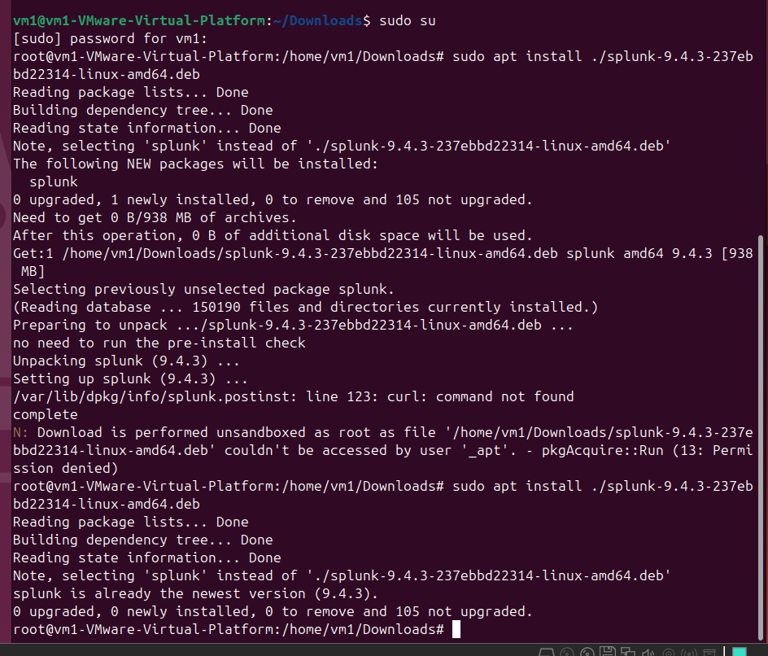

## Splunk first startup (source page 5, image 1)

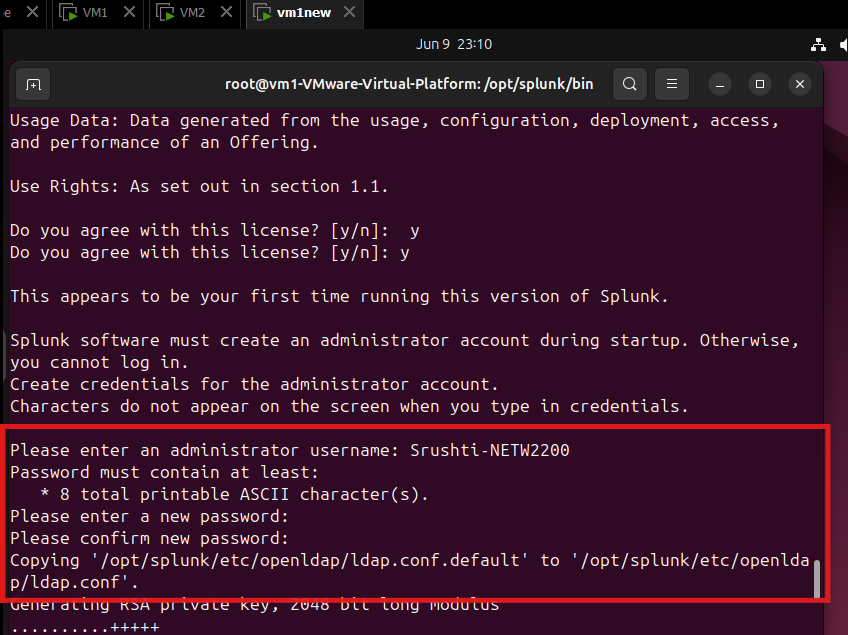

## Splunk server startup (source page 6, image 1)

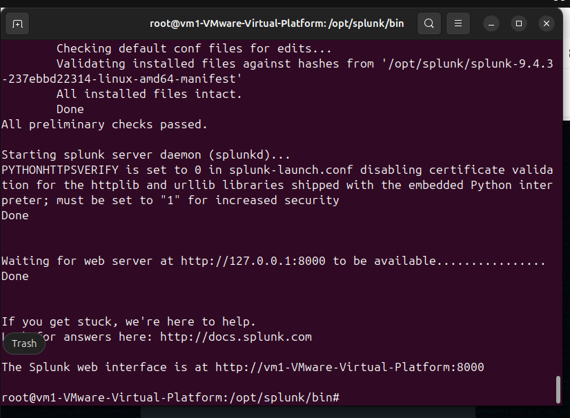

## Receiving-port setup (source page 7, image 1)

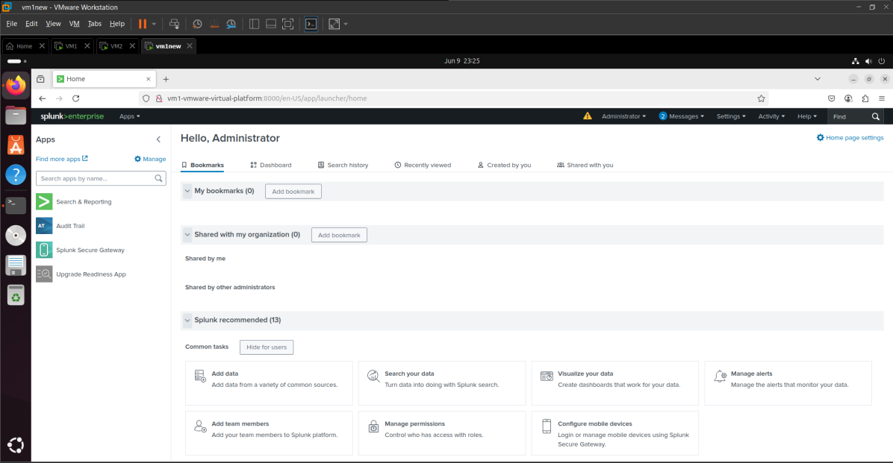

## Receiving-port setup (source page 7, image 2)

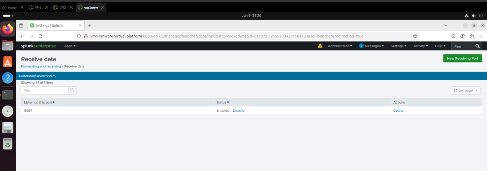

## Listener verification (source page 8, image 1)

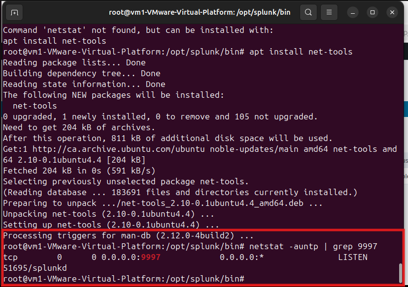

## Forwarder startup (source page 9, image 1)

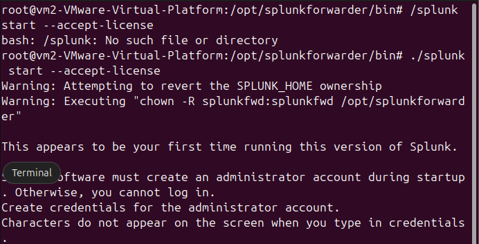

## Forwarder account and destination (source page 10, image 1)

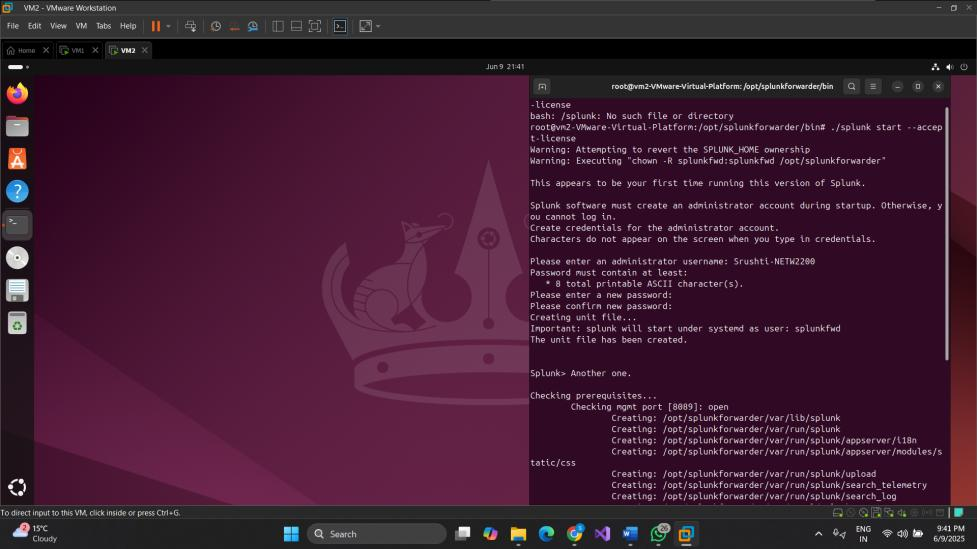

## Forwarder account and destination (source page 10, image 2)

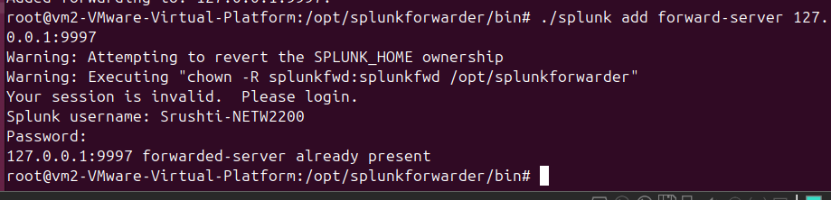

## Authentication-log monitor (source page 11, image 1)

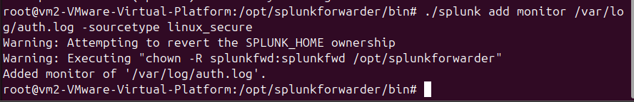

## Search and data summary (source page 12, image 1)

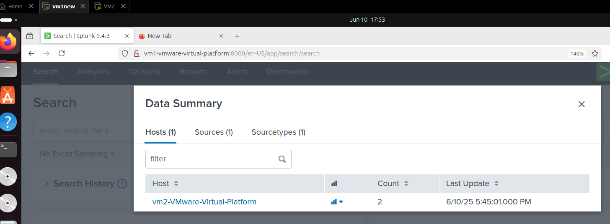

## Search and data summary (source page 12, image 2)

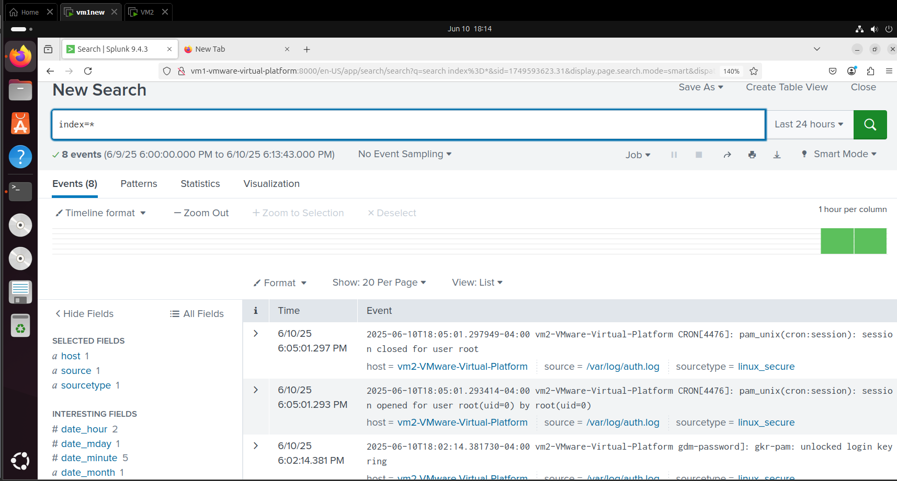

## Source and sourcetype (source page 13, image 1)

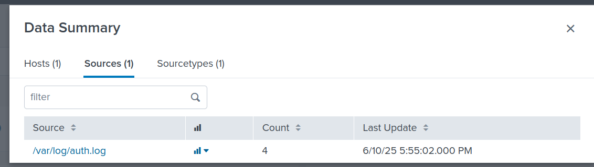

## Source and sourcetype (source page 13, image 2)

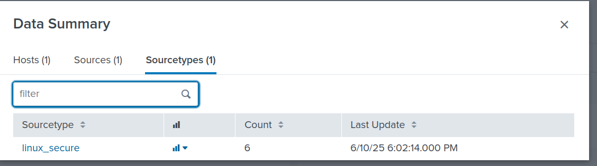

## Index and server fields (source page 14, image 1)

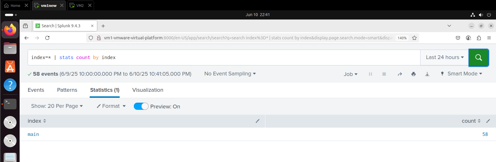

## Index and server fields (source page 14, image 2)

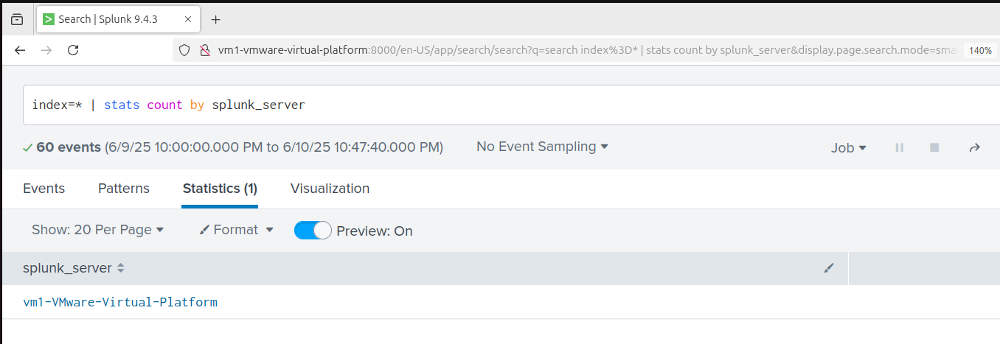

## Authentication-event search (source page 15, image 1)

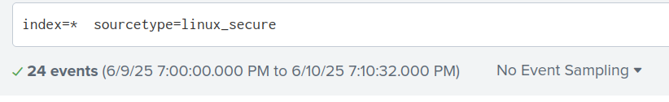

## Authentication-event search (source page 15, image 2)

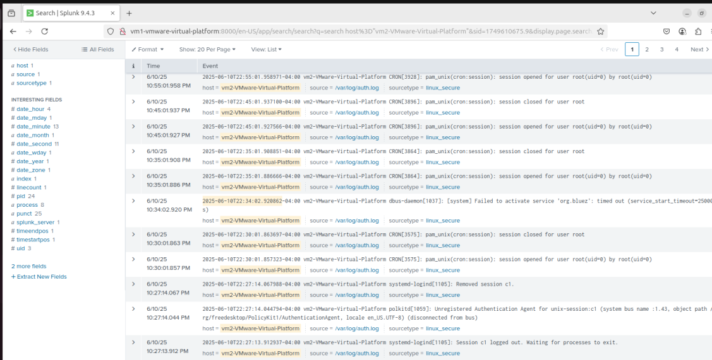

